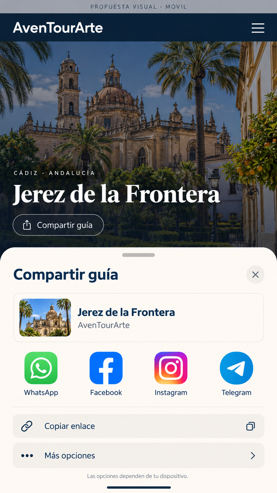

# Referencia visual para el futuro rediseño

Guardada el 14 de octubre de 2026 a petición del usuario. Es una maqueta generada con ImageGen y aprobada como referencia visual para un futuro rediseño; no es una captura de la web ni del menú real de un teléfono.

Ideas que conservar: fotografía protagonista, tipografía con jerarquía clara, azul marino y crema, superficies limpias, tarjeta del destino y controles cómodos en móvil. La propuesta sirve para explorar el diseño; no autoriza un rediseño completo ahora.

## Compartir una guía: alcance acordado

Una acción «Compartir guía» abre directamente el menú nativo del dispositivo. El teléfono ofrece las aplicaciones compatibles que tiene disponibles. La web no puede enumerar esas aplicaciones ni decidir el aspecto del menú. Los iconos de WhatsApp, Facebook, Instagram y Telegram de esta imagen son ilustrativos.

Si el navegador no admite compartir, se ofrece «Copiar enlace». Si el portapapeles falla, se muestra el enlace seleccionable. Compartir y copiar usan siempre la URL limpia del destino, sin parámetros editoriales.

La maqueta original se conserva en `C:/Users/alfre/.codex/generated_images/01a13bd9-30d3-7132-ab81-a7b287b2befc/exec-a9ba5540-8b0a-407f-9ef2-ebe89bbbfeac.png`; esta copia en el proyecto permite recuperar la referencia sin depender de esa ubicación.
